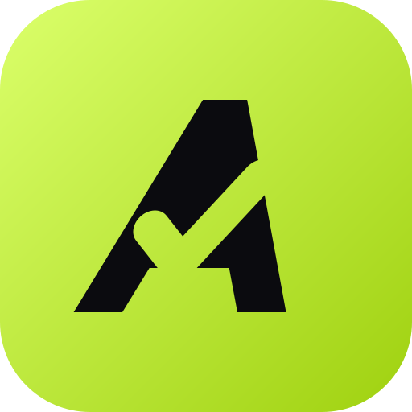
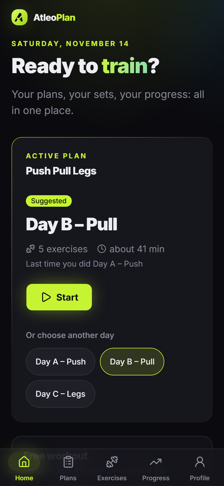
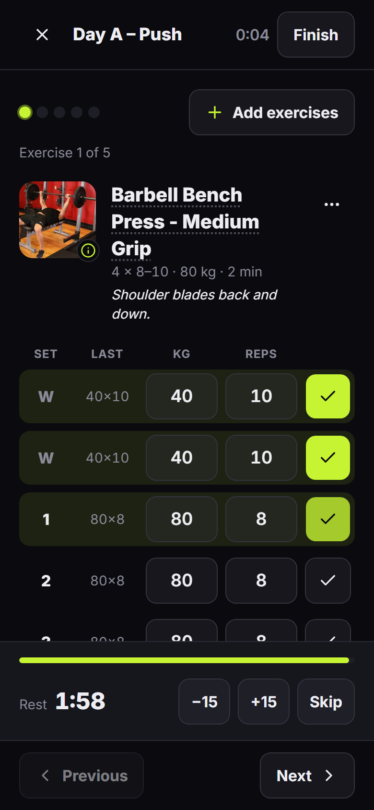
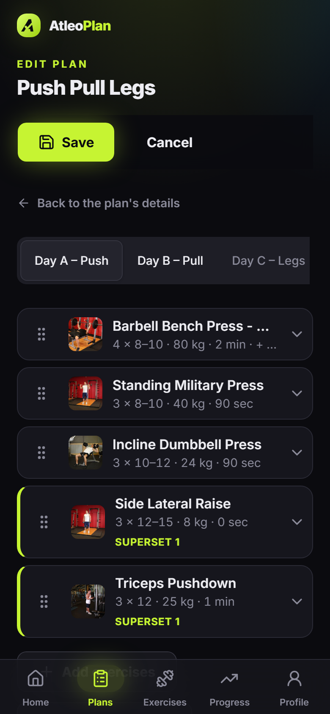
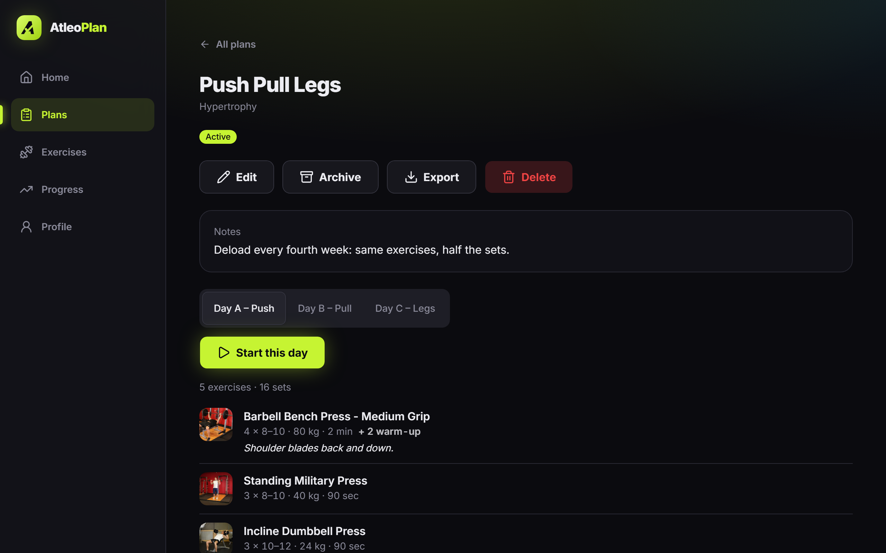
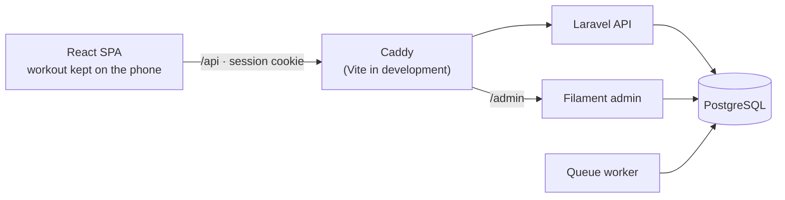

<p align="center">
  
</p>

<h1 align="center">AtleoPlan</h1>

<p align="center">
  A workout app for the gym: plans, workout mode set by set, progress against last time.<br>
  <em>Your plans, your progress.</em>
</p>

<p align="center">
  <a href="https://github.com/alesssz/AtleoPlan/actions/workflows/ci.yml"></a>
</p>

AtleoPlan builds training plans from a library of almost 900 exercises, follows them set by set on the phone, and compares each exercise with last time. A Laravel API and a React + TypeScript single-page app, in four languages, designed phone first. In development, not deployed yet.

<p align="center">
  
  
  
</p>

<p align="center">
  
</p>

## Features

- **Exercise library** of 876 exercises from free-exercise-db plus calisthenics of our own, in four languages; search across every language and alias, filters by muscle and equipment; personal exercises with photos.
- **Plans** with days, sets and their types (warm-up, drop, to failure), supersets and drag and drop; the draft survives a closed tab; a plan exported as a file and imported on another server.
- **Workout mode**: one tap per set, pre-filled with last time's values; a rest timer with sound and vibration; a stopwatch for timed sets; swap, skip or annotate an exercise; the screen kept on.
- **Progress**: Home suggests the next day and sums up the week; after a workout, each exercise is compared with last time; history by month.
- **Accounts** with email and password or Google; language, theme, unit (kg or lb) and workout preferences follow the user across devices.
- **Admin panel** for the public library, its translations still to review, and the users.

All of it, screen by screen: [D1. UI design](docs/design/D1-ui.md).

## Engineering highlights

- **A workout survives a gym with no signal.** It lives on the phone while it runs, and is sent at the end with a `PUT` to a UUID the phone created: a retry after a lost answer replaces it instead of duplicating it, and a workout deleted meanwhile answers `410 Gone`, so the queue stops retrying. ([C2.5.7](docs/concepts/C2-backend.md#c257-the-workouts-endpoints))
- **Timers that are right after the phone sleeps.** Browsers throttle background timers, so the rest timer and the stopwatch store the moment they end or started, never a countdown; the screen derives the time left from the clock. ([C1.17.4](docs/concepts/C1-frontend.md#c1174-the-rest-timer-a-moment-not-a-countdown))
- **A plan is saved as one tree.** Days, exercises and sets go in one request and one transaction, rows matched by their UUIDs; a version number with a row lock tells the editor when someone saved the same plan elsewhere in the meantime. ([C2.5.5](docs/concepts/C2-backend.md#c255-the-plans-endpoints))
- **Comparisons that mean something.** A workout's total volume adds a kilogram of squat to a kilogram of curl and weighs a calisthenics workout at zero, so each exercise is compared with its own last time instead: estimated one-rep max, reps, or time. ([C1.19.3](docs/concepts/C1-frontend.md#c1193-better-than-last-time-exercise-by-exercise))
- **The rules live in plain code.** Laravel controllers only authorise, validate and delegate to actions tested without HTTP; the React editor and workout run on pure reducers with "now" passed in, tested without rendering. ([C1.4](docs/concepts/C1-frontend.md#c14-component-conventions), [C2.2](docs/concepts/C2-backend.md#c22-code-conventions))
- **Tested and checked on every push.** Pest covers every endpoint with its forbidden cases, on a test database guarded against mistakes; Vitest drives pages through the real router with a fake API, by role and accessible name; CI adds the build, a weekly dependency audit and CodeQL. ([H5](docs/how-to/H5-ci.md))

## Tech stack

React 19 (TypeScript strict, Vite) · TanStack Query · React Router · react-hook-form and zod · i18next · Tailwind CSS 4 and shadcn/ui · dnd-kit · Laravel 13 (PHP 8.4, FrankenPHP) · Sanctum and Fortify · Filament 5 · PostgreSQL 18 · Pest, Vitest and Testing Library · Docker Compose · GitHub Actions. Why each one: [D2. Decisions](docs/design/D2-decisions.md#d22-stack).



## Quick start

Requires Docker and Node 24; on Windows, run the commands from Git Bash. `make doctor` checks everything and prints the fix for anything missing.

```sh
make setup             # images, packages, database
make fresh             # reference data and the development account
make exercises-import  # the exercise library (downloads free-exercise-db once)
make start             # backend and React app with hot reload
```

Open http://localhost:5673 and sign in with `test@example.com` / `password`; `make plans-demo` adds two example plans. `make check` runs every check; `make help` lists every command. A new computer from scratch, ports and known problems: [S1. Setup](docs/start/S1-setup.md).

## Documentation

| Section | Contents |
|---|---|
| [S1. Setup](docs/start/S1-setup.md) | From a new computer to the app running; ports, commands, known problems |
| [D1. UI design](docs/design/D1-ui.md) | Users, navigation, every screen, design system, states, accessibility |
| [D2. Decisions](docs/design/D2-decisions.md) | Stack, exercise library, languages, media, hosting, offline, workout rules |
| [D3. Data model](docs/design/D3-data-model.md) | Every table, ids, what happens on delete, traps |
| [C1. Frontend](docs/concepts/C1-frontend.md) | The React app's architecture, feature by feature |
| [C2. Backend](docs/concepts/C2-backend.md) | The Laravel API's architecture, endpoints, admin panel, imports |
| [H1–H5. How-to](docs/how-to) | Recipes: tables, endpoints, pages, the database client, CI |
| [P1. Conventions](docs/project/P1-conventions.md) | Git, code, comments, docs, the public repository |

Every document is indexed in [docs/README.md](docs/README.md); work known and waiting is in the [backlog](docs/project/backlog.md).

## Status

Everything above runs locally; deploying is [OPS-3](docs/project/backlog.md#ops-3-deploy-to-the-free-server). Next come the offline app (a PWA that opens with no network), then progress charts, records, shared plans and exercise videos.

A personal project, made public to be read. There is no licence: the code can be read and studied, but all rights are reserved. A security problem is reported privately, as [SECURITY.md](SECURITY.md) says.
